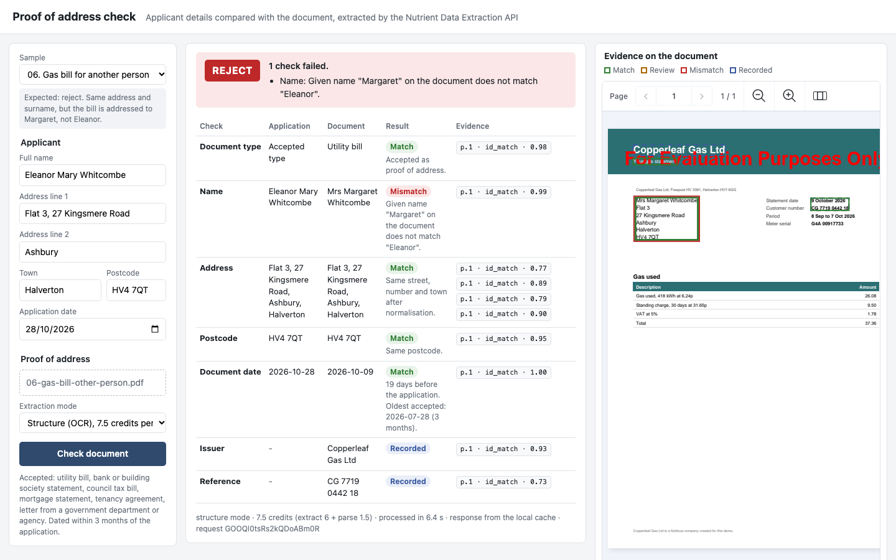
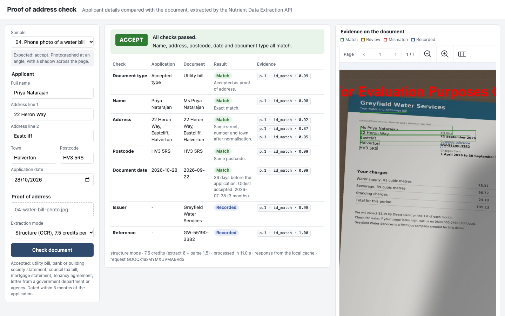
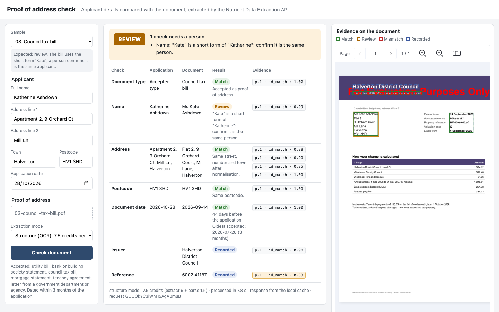

# Nutrient Proof of Address Check

A Nutrient.io demo that checks a proof-of-address document for KYC onboarding: the Nutrient Data Extraction API reads the document, and simple rules compare it with the application and decide accept, review or reject, with reasons and the evidence on the page.



1. **Application.** An applicant types their name, address and postcode, and uploads a utility bill, bank statement, council tax bill or a phone photo of a letter. The application date is part of the form.
2. **Extraction.** The Node.js server sends the file to the Data Extraction API extract endpoint (`POST /extraction/extract`) with a JSON Schema: document type, issuer, holder name, address lines, town, postcode, document date and account reference. The default parse mode is `structure` (OCR), the cheapest mode the extract endpoint accepts.
3. **Evidence.** Every value comes back with a citation: page, bounding box, a match label (`id_match`, `fuzzy_match`, `not_found`...) and a grounding score.
4. **Rules.** The server compares the application with the document:
   - **Name**: tolerant to titles, capitals, accents, initials, middle names and surname-first order. A known short form (Kate for Katherine) or a one-letter spelling difference goes to review. Another given name is a mismatch.
   - **Address**: normalised (Rd and Road, St and Street or Saint, Ct, Ln, Apartment and Flat...). The house number must be on the document, the flat number must not differ, and the street and town words must match.
   - **Postcode**: same postcode, ignoring spaces and case.
   - **Date**: the issue or statement date must be within 3 months before the application date.
   - **Type**: only accepted document types (utility bill, bank or building society statement, council tax bill, mortgage statement, tenancy agreement, government letter).
   - **Grounding**: a key value with a `fuzzy_match` or `not_found` citation sends the case to review.
5. **Decision.** Any mismatch rejects the document, anything uncertain goes to a person, otherwise it is accepted. The decision card lists the reasons and compares each field.
6. **Viewer.** The Nutrient Web SDK shows the uploaded document with one outlined box per citation, coloured by the result of the check. Click an evidence chip to jump to it.

The API key stays on the server. The browser only gets the result.

## Prerequisites

- Node.js 20 or later (no npm packages are needed)
- A Nutrient Data Extraction API key
- Internet access to `api.nutrient.io` and to the Web SDK CDN
- Windows, macOS or Linux
- Python 3.10 or later, only to regenerate the samples

## Environment variables

Start from `.env.example`. The server reads `.env` from the working directory if it exists, otherwise the process environment.

| Variable | Purpose | Default |
|---|---|---|
| `NUTRIENT_API_KEY` | Data Extraction API key, required. Get an API key at https://dashboard.nutrient.io/sign_in/. At the time of writing, the free plan includes 5,000 credits per month to test the Data Extraction API. | none |
| `WEB_SDK_LICENSE_KEY` | Web SDK license key for the viewer, sent to the browser | empty = evaluation mode |
| `EXTRACTION_MODE` | Default parse mode: `structure`, `understand` or `agentic` | `structure` |
| `EXTRACTION_CACHE_DIR` | Folder where API responses are kept, keyed by file, mode and schema, so the same document is only paid for once while you develop | empty = no cache |
| `PORT` | Port of the server | `4740` |

Without `NUTRIENT_API_KEY` the page loads, shows a warning, and every check returns an error with the link above. In evaluation mode the viewer shows a watermark on the page.

## Build and run

```bash
cp .env.example .env
```

Set `NUTRIENT_API_KEY` in `.env`, then:

```bash
npm start
```

Open <http://localhost:4740>.

To run the rule tests (offline, no API call):

```bash
npm test
```

To run the six samples through the API and measure field accuracy, decisions and credits (45 credits in `structure` mode):

```bash
npm run evaluate
```

## Using the app

1. Pick a sample in **Sample**. It fills in the applicant and loads the document. The note under the list says which decision is expected and why.
2. Or type the applicant details and choose your own PDF, JPEG, PNG or TIFF.
3. Choose the **Extraction mode**. `structure` is enough for the samples, including the phone photo.
4. Click **Check document**.
5. Read the decision and the reasons. The table compares each field: what the applicant typed, what the document says, the result, and the evidence chips (`p.1 · id_match · 0.99` is page 1, match label and grounding score). A low grounding score is shown in amber.
6. The viewer outlines each cited value on the document and zooms on them. Click a chip to select its box.

The phone photo of a water bill, taken at an angle with a shadow across it, is read in `structure` mode and accepted:



A council tax bill addressed to "Kate" for an applicant called Katherine goes to review:



### Run a sample from the URL

`http://localhost:4740/?sample=6&run` loads sample 6 and checks it.

## API

| Method and path | Description |
|---|---|
| `GET /api/config` | Modes and prices, accepted types, the 3-month window, samples, Web SDK license key |
| `POST /api/check` | multipart: `file`, `applicant` (JSON: `fullName`, `addressLine1`, `addressLine2`, `town`, `postcode`, `applicationDate`) and `mode`. Returns `{ decision, reasons, checks, document, extraction, cost, usage, processingTimeMs, requestId }` |
| `GET /samples/{file}` | A sample document |

## Results on the samples

Measured with `npm run evaluate` and the Data Extraction API on 31 October 2026.

| Sample | Expected | Decision | Main reason |
|---|---|---|---|
| 01 Electricity bill | accept | accept | Middle initial and "Rd" for "Road" tolerated |
| 02 Bank statement, first page | accept | accept | Accents, capitals and "St" for "Saint" tolerated |
| 03 Council tax bill | review | review | "Kate" is a short form of "Katherine" |
| 04 Phone photo of a water bill | accept | accept | Read from the photo |
| 05 Broadband bill | reject | reject | Dated 170 days before the application |
| 06 Gas bill for another person | reject | reject | Given name "Margaret" instead of "Eleanor" |

Field accuracy against what is printed on the samples (8 fields per document: type, issuer, name, address lines, town, postcode, date, reference):

| Parse mode | Credits per page | Field accuracy | API processing time per page |
|---|---|---|---|
| `structure` | 7.5 (parse 1.5 + extract 6) | 48/48 | 4.8 to 13.5 s |
| `understand` | 15 (parse 9 + extract 6) | 48/48 | 5.1 to 7.4 s |
| `auto` (tested on samples 01 and 04) | 24 (agentic 18 + extract 6) | 16/16 | 10.8 and 26.2 s |

`auto` sent both pages, even the simple born-digital bill, to the `agentic` parser, at 3.2 times the price of `structure` for the same values. `structure` returns smaller boxes (one per line or block) than `understand`, which helps the viewer. The issuer of sample 02 is printed twice, "Fernvale Bank" in the header and "Fernvale Bank plc" in the footer; both count as correct.

## Cost

One check of a one-page document in `structure` mode costs 7.5 credits, read from `usage.price_composition` in the API response: 1.5 for the parse stage and 6 for the extract stage. Checking the six samples once costs 45 credits (90 in `understand` mode). Use `EXTRACTION_CACHE_DIR` while you develop so that repeated checks of the same file are free.

## Samples

`samples/` holds six one-page documents and `samples/manifest.json`, which lists for each one the applicant data, the expected decision and the values printed on it. Every company, person, address and number is invented; the `HV` postcode area does not exist. To regenerate them:

```bash
pip install -r samples/requirements.txt
```

```bash
python samples/generate_samples.py
```

## Project layout

| Path | Content |
|---|---|
| `server.js` | HTTP server, upload handling and the `/api/check` endpoint |
| `src/extract.js` | Data Extraction API call, cost logging and the optional cache |
| `src/schema.js` | JSON Schema and instructions sent to the extract endpoint |
| `src/rules.js` | Name, address, postcode, date and type rules, and the decision |
| `public/` | Applicant form, decision card and the viewer (Web SDK 1.24.0 from the Nutrient CDN) |
| `scripts/evaluate.js` | Field accuracy and decisions on the samples |
| `test/` | Offline tests of the rules |
| `samples/` | Fictitious documents, manifest and their generator |

## Limitations

- The rules are written for UK-style addresses and English names. The short-form list is small.
- Only the first page of a multi-page document is needed for these checks, but the API bills every page you send.
- The grounding score did not separate right from wrong values on the samples: correct values scored as low as 0.14. The rules use the match label instead, and only show the score.
- A document that passes every check can still be forged. This demo does not check fonts, metadata or tampering.
- The Data Extraction API runs in the cloud. Read the Nutrient DWS privacy terms before you send real customer documents.
